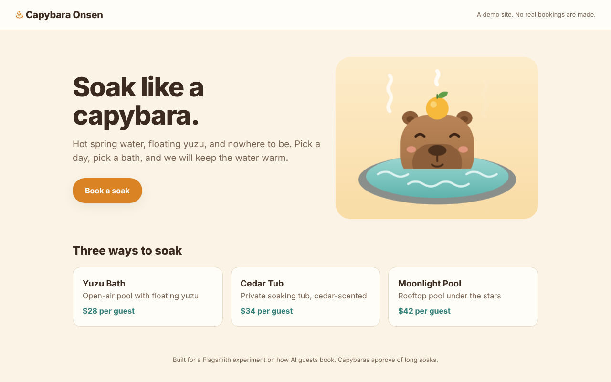
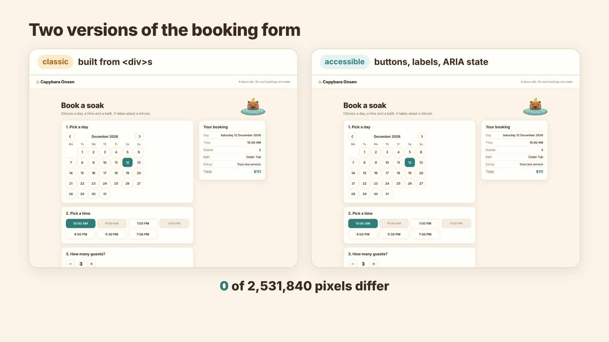
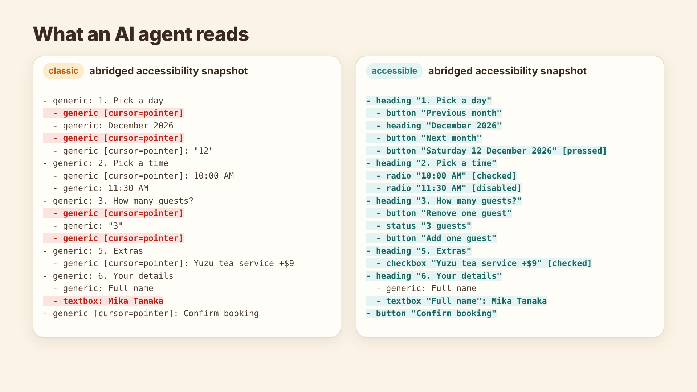
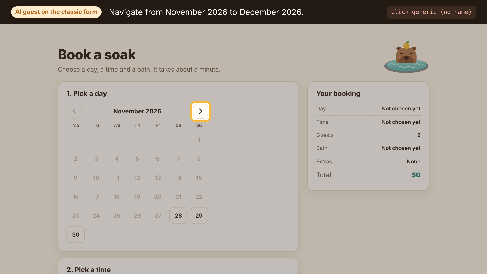
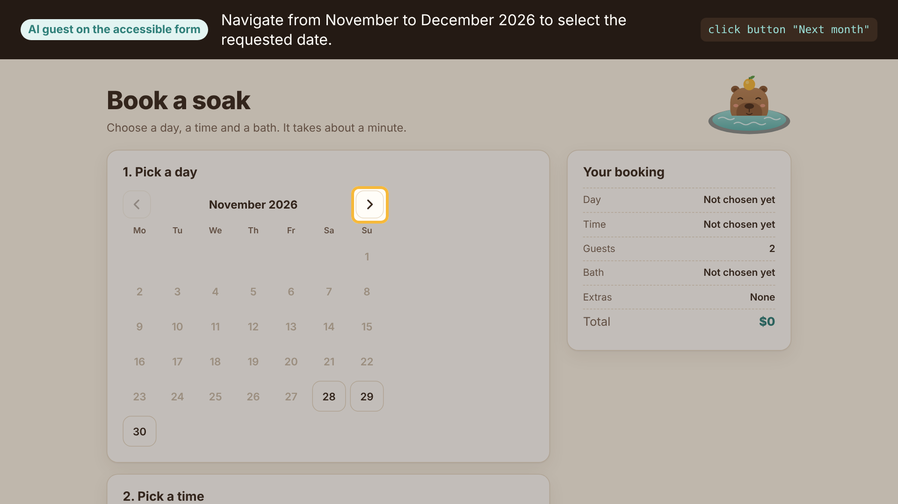

# Capybara Onsen

**Does an accessibility upgrade help, or hurt, the AI agents that book on your site? We ran the experiment on Flagsmith, with agents that drive real browsers.**



Capybara Onsen is a hot-spring booking site with two versions of its booking form behind one Flagsmith feature flag. A person cannot tell them apart: they are identical, pixel for pixel. An AI agent can, because it reads the accessibility tree, where one version is a pile of unnamed `<div>`s and the other has buttons with names and state.

A Flagsmith experiment splits AI guests between the two versions and counts correct bookings, completed bookings, steps and tokens. Each guest is a language model operating a real browser, so nobody types in a conversion rate. The result is whatever the agents do.

> **Status.** The production experiment is pre-registered and passes its pre-launch check. It starts when a person approves it, and this section will then carry its result. Three Staging runs (300 guests) are summarised under [Results so far](#results-so-far).

Built for [Toggle Wars: The Flagsmith Experimentation Hackathon](https://www.wemakedevs.org/hackathons/flagsmith). One project, entered in all four tracks; see [The four tracks](#the-four-tracks).

## Two versions that look the same



`npm run parity` drives both versions through the same clicks and compares full-page screenshots at three stages. Zero pixels differ.

The **classic** version is built the way a lot of hand-rolled UI is: clickable `<div>`s, visual labels that are not tied to their inputs, icon-only controls with no name, and state (selected, ticked, sold out) shown only through styling. These are the failures [WebAIM's 2026 survey of the top million home pages](https://webaim.org/projects/million/) finds most often in markup: missing form labels on 51% of pages and empty buttons on 30.6%. The **accessible** version is the same design in `<button>`, `<label>`, headings and groups, with names for icon-only controls and ARIA state.

## And read completely differently



This is what the guests see: Playwright's AI-mode accessibility snapshot, the same representation Playwright's own MCP server gives coding agents. On the left, the "next month" arrow and the guest stepper are clickable elements with no name at all.

## The experiment

The onsen wants to ship the accessible form to everyone. That release is for people. The experiment asks what it does to AI guests.

We started out expecting the accessible form to raise correct bookings. Two pilots showed correct bookings at 100% in both versions, so that could not be tested on this form with this guest model. What the release decision needs is whether the accessible form does any harm to AI guests, and what it costs them. The full reasoning, design and decision rule are in the pre-registration, [experiments/HYPOTHESIS.md](experiments/HYPOTHESIS.md), committed before any production data existed.

| | Metric (event) | Registered expectation |
|---|---|---|
| H1, primary | Correct booking (`booking_correct`) | should not decrease |
| H2 | Booking completed (`booking_completed`) | should not decrease |
| H3 | Guest steps (`guest_steps`) | should not increase |
| H4 | Guest tokens (`guest_tokens`) | should not increase |

- **Units.** AI guests: `Qwen/Qwen3.8-27B` driving Chromium, one fresh browser context and identity each. A guest gets a booking brief in plain language, reads each page as an accessibility snapshot, and replies with one click or fill at a time. It never sees pixels, the DOM, or which version it was served.
- **Assignment.** A Flagsmith experiment on the multivariate flag `booking_form`, split 50/50.
- **Events.** The exposure is recorded when the site reads the flag with `getExperimentFlag`. The site sends `booking_completed` when it stores a booking. Afterwards the harness compares stored bookings with each brief and sends `booking_correct`, `guest_steps` and `guest_tokens`.
- **Correct** means exactly one booking, matching the brief on every field: day, time (the preferred one, or the next later one if it is sold out), guests, bath, extras, name and email.

| A guest on the classic form | A guest on the accessible form |
|---|---|
|  |  |

## Results so far

These are Staging runs, used to debug the harness and size the experiment. They are not the registered experiment.

| Run | Guests | Correct, classic | Correct, accessible | Actions per guest | Tokens per guest |
|---|---|---|---|---|---|
| Pilot 2 | 60 | 25 of 25 | 35 of 35 | 11.7 and 11.5 | 31,630 and 37,414 (+18%) |
| Skill test 1 | 120 | 63 of 63 | 57 of 57 | 11.8 and 12.0 | 31,902 and 38,954 (+22%) |
| Skill test 2 | 120 | 55 of 55 | 65 of 65 | 12.2 and 11.8 | 32,915 and 38,215 (+16%) |

The two skill tests were run end to end by a fresh agent using only the skill (see [The four tracks](#the-four-tracks)). Flagsmith's verdict on the first, as `fx results` printed it:

```
Booking correct (primary)  control 63/63 100%  accessible 57/57 100%  lift +0% [+0%, +0%]  chance 50%  guardrail ok
Booking completed  control 63/63 100%  accessible 57/57 100%  lift +0% [+0%, +0%]  chance 50%  guardrail ok
Guest steps  control n=63 mean 11.83  accessible n=57 mean 11.98  lift +1.3% [-3.3%, +6%]  chance 28.8%  guardrail ok
Guest tokens  control n=63 mean 31901.54  accessible n=57 mean 38954.04  lift +22.1% [+15.9%, +28.3%]  chance 0%  GUARDRAIL BREACHED
sample ratio: ok (control 63 / variation 57, expected 50/50, p=0.584)
```

An earlier pilot of 80 guests found two problems in our own set-up, both fixed before these runs: the guests were shown Playwright's raw element references, whose format changes between pages, and several accessible controls carried an `aria-label` that only repeated their visible text.

## How Flagsmith is used

| Flagsmith feature | Where | What it does here |
|---|---|---|
| Multivariate feature flag | `booking_form`, read in [app/server.mjs](app/server.mjs) | Chooses the form version for each visitor. Ships the winner with the same flag. |
| Experimentation | [experiments/booking_form.json](experiments/booking_form.json) | 50/50 split, four metrics, guardrails through "should not" expectations, Bayesian results. |
| Node SDK (`@flagsmith/nodejs`) | [app/server.mjs](app/server.mjs), [guests/run.mjs](guests/run.mjs) | `getExperimentFlag` records exposures; `trackEvent` sends the conversion and audit events. |
| Flagsmith CLI v2 | [skills/flagsmith-experiment/scripts/fx](skills/flagsmith-experiment/scripts/fx) | Creates the flag, variation, metrics and experiment; probes with `flagsmith evaluate`; reads results; rolls out. |
| Self-hosted, open source | [docker-compose.yml](docker-compose.yml), [scripts/bootstrap.mjs](scripts/bootstrap.mjs) | Flagsmith 2.295 with events stored in its own PostgreSQL. No cloud account. |
| Environments | Staging and Production | Staging is a sandbox an agent may run alone. Production needs a named person. |
| Identity overrides | the video's two recorded guests | Pins one identity to each version so the same brief can be filmed on both. |

## Run it yourself

You need Docker with Compose v2, Node 22 or later, `jq`, the [Flagsmith CLI](https://docs.flagsmith.com/integrating-with-flagsmith/CLI) v2, and an API key for any OpenAI-compatible chat endpoint (the guests).

```bash
cp .env.example .env    # then fill in OPENAI_BASE_URL, OPENAI_API_KEY and OPENAI_MODEL
```

```bash
./scripts/demo.sh
```

That one command starts Flagsmith, creates the admin account, project and environments, starts the booking site, sets the experiment up, rehearses it, runs the pre-launch check, starts it in Staging, sends 120 AI guests through it, and prints Flagsmith's results. It takes about 15 minutes, most of it the guests. It never ships; you decide:

```bash
skills/flagsmith-experiment/scripts/fx ship --flag booking_form --winner accessible --approved-by "Your name"
```

```bash
skills/flagsmith-experiment/scripts/fx stop --flag booking_form
```

The dashboard is at http://localhost:8000 (the login is in `.flagsmith/state.json`). The site is at http://localhost:3000; `/preview/classic` and `/preview/accessible` show each version without enrolling you.

## What is in the repo

| Path | What it is |
|---|---|
| `app/` | The booking site. `public/booking.js` draws both versions of the form from one renderer. |
| `guests/` | The AI guests: the agent loop, seeded booking briefs, the audit, and the runner. |
| `experiments/` | The experiment spec, the pre-registration, and results. |
| `skills/flagsmith-experiment/` | The Agent Skill: `SKILL.md`, the `fx` script, and a reference. |
| `scripts/` | Instance bootstrap, the one-command demo, the parity check, the report generator. |
| `video/` | The demo video's script and the pipeline that builds it. |
| `docs/` | Images, and [notes for the Flagsmith team](docs/flagsmith-feedback.md). |

## The four tracks

**Track 1, Test Something Real.** One experiment. A hypothesis registered before the data, two versions behind one flag, metrics from real events, and results explained with the guests' own transcripts. The traffic is simulated in the sense the brief allows, but the outcomes are not scripted: every booking is a model succeeding or failing at a real form.

**Track 2, AI Agents and Feature Flags.** The whole experiment is run by a coding agent through the Flagsmith CLI. It acts alone where nothing changes for users (set-up, checks, reading results) and in an environment a person has marked as a sandbox. It stops for a named person before it starts an experiment and before it ships one, and it will not ship over a breached guardrail on its own. Every start, ship and stop is appended to an approvals log.

**Track 3, Build on Open Source Flagsmith.** Everything runs on self-hosted Flagsmith from one command. Three pieces are meant to be reused: `scripts/bootstrap.mjs` sets up a fresh instance without touching the dashboard, `guests/guest.mjs` drives an AI guest through any site given a URL and a task in plain language (the briefs and the audit here are specific to the onsen), and `fx` runs any two-version experiment.

**Track 4, Flagsmith Agent Skills.** [skills/flagsmith-experiment](skills/flagsmith-experiment/SKILL.md) takes an agent through the whole job on the Flagsmith CLI: plan, check, human-approved start, results with a verdict, rollout.
- *Completes the whole job.* Twice, a fresh agent given only the skill and the location of the app ran the experiment end to end in Staging. Both times the token guardrail was breached. In the second test the agent tried to ship the variation, `fx` refused, and the agent stopped the experiment instead.
- *Token efficiency.* `SKILL.md` is about 1,600 tokens and `fx` prints one fact per line. The first test took 26 tool calls and 117,084 tokens. After we rewrote the instructions from that agent's feedback, the second took 15 tool calls and 104,707 tokens, including the extra ship attempt. These are the agent harness's totals, which count the agent's own system prompt on every turn and its written report.
- *Creative use of the CLI.* `flagsmith evaluate --identity` on throwaway identities proves that nothing is live before a start and that the rollout is live after it. The warehouse's list of received event names catches a misspelt event before it costs a day. `--jq` keeps every call to the few fields needed.
- *Safety.* Experiments are created and started in one approved step, because a created experiment already serves its variation. Stop is always allowed. Ship refuses an inconclusive primary metric, a breached guardrail or a broken split.

## Notes for the Flagsmith team

Experimentation is in beta, and building on it turned up three things worth knowing. Details and reproductions are in [docs/flagsmith-feedback.md](docs/flagsmith-feedback.md).

1. With the payload from the agent set-up guide, an experiment serves its variation as soon as it is created, before it is started.
2. The sample-ratio check does not run when the variation was added with weight 0, which is what the guide instructs.
3. When both versions convert at 100%, the dashboard announces a confirmed winner at 50% probability.

## Limits

- One guest model, one way of perceiving pages (the accessibility snapshot, no screenshots), and one form. A weaker model, or an agent that works from screenshots, may behave differently.
- The form echoes every selection as text in a summary card, so state is readable in both versions. A form without that echo would test the classic version harder.
- Correct bookings sit at 100% in both versions, so this experiment can show that the accessible form does no harm to bookings. It cannot show that it helps.
- The token cost falls on whoever runs the agent, not on the site. It matters to a site only as far as cheaper visits make agents likelier to finish.

## How this was built

The code was written with an AI coding assistant, which the hackathon rules allow. The comments and this README are written so that every part can be read and explained.
