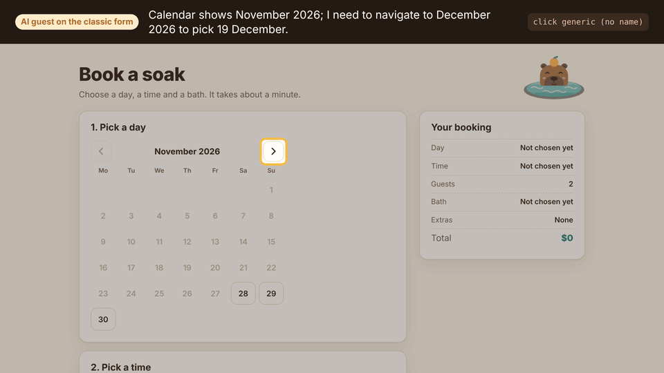

# Capybara Onsen

**Does an accessibility upgrade help, or hurt, the AI agents that book on your site? We ran the experiment on Flagsmith, with agents that drive real browsers.**


Capybara Onsen is a hot-spring booking site with two versions of its booking form behind one Flagsmith feature flag. A person cannot tell them apart: they are identical, pixel for pixel. An AI agent can, because it reads the accessibility tree, where one version is a pile of unnamed `<div>`s and the other has buttons with names and state.

A Flagsmith experiment splits AI guests between the two versions and counts correct bookings, completed bookings, steps and tokens. Each guest is a language model operating a real browser, so nobody types in a conversion rate. The result is whatever the agents do.

> **Result, from 300 AI guests.** Every guest made a correct booking on both versions: 156 of 156 on classic, 144 of 144 on accessible. On the classic form 24 guests took a detour first, usually one or two wasted clicks on a sold-out time that the form marks only by how it looks. On the accessible form none did. But the accessible form cost 13.6% more tokens per guest, which breached a guardrail, so the tooling refused to ship it until a person accepted that cost. A person did, and it shipped. This is the outcome we had registered in advance. The wasted actions and the token cost showed up again in five other runs on the same set-up: of 840 guests in all, 45 of 418 on the classic form wasted at least one action, and none of 422 on the accessible form did. Details under [Results](#results).

**Demo video, 3 minutes 40 seconds:** [docs/capybara-onsen-demo.mp4](docs/capybara-onsen-demo.mp4), with captions in [docs/capybara-onsen-demo.srt](docs/capybara-onsen-demo.srt).

Built for [Toggle Wars: The Flagsmith Experimentation Hackathon](https://www.wemakedevs.org/hackathons/flagsmith). One project, entered in all four tracks; see [The four tracks](#the-four-tracks).

## Two versions that look the same


`npm run parity` drives both versions through the same clicks and compares full-page screenshots at three stages. Zero pixels differ.

The **classic** version is built the way a lot of hand-rolled UI is: clickable `<div>`s, visual labels that are not tied to their inputs, icon-only controls with no name, and state (selected, ticked, sold out) shown only through styling. These are the failures [WebAIM's 2026 survey of the top million home pages](https://webaim.org/projects/million/) finds most often in markup: missing form labels on 51% of pages and empty buttons on 30.6%. The **accessible** version is the same design in `<button>`, `<label>`, headings and groups, with names for icon-only controls and ARIA state.

## And read completely differently


This is what the guests see: Playwright's AI-mode accessibility snapshot, the same representation Playwright's own MCP server gives coding agents. On the left, the "next month" arrow and the guest stepper are clickable elements with no name at all.

## The experiment

The onsen wants to ship the accessible form to everyone. That release is for people. The experiment asks what it does to AI guests.

We started out expecting the accessible form to raise correct bookings. Two pilots showed correct bookings at 100% in both versions, so that could not be tested on this form with this guest model. What the release decision needs is whether the accessible form does any harm to AI guests, and what it costs them. The full reasoning, design and decision rule are in the pre-registration, [experiments/HYPOTHESIS.md](experiments/HYPOTHESIS.md), committed before the production experiment was started.

| | Metric (event) | Registered expectation |
|---|---|---|
| H1, primary | Correct booking (`booking_correct`) | should not decrease |
| H2 | Booking completed (`booking_completed`) | should not decrease |
| H3 | Guest steps (`guest_steps`) | should not increase |
| H4 | Guest tokens (`guest_tokens`) | should not increase |

- **Units.** AI guests: `Qwen/Qwen3.8-27B`, served by Weights & Biases Inference through its OpenAI-compatible API, driving Chromium, one fresh browser context and identity each. A guest gets a booking brief in plain language, reads each page as an accessibility snapshot, and replies with one click or fill at a time. It never sees pixels, the DOM, or which version it was served.
- **Assignment.** A Flagsmith experiment on the multivariate flag `booking_form`, split 50/50.
- **Events.** The exposure is recorded when the site reads the flag with `getExperimentFlag`. The site sends `booking_completed` when it stores a booking. Afterwards the harness compares stored bookings with each brief and sends `booking_correct`, `guest_steps` and `guest_tokens`.
- **Correct** means exactly one booking, matching the brief on every field: day, time (the preferred one, or the next later one if it is sold out), guests, bath, extras, name and email.



Two guests with the same brief, filmed for the video with one identity pinned to each version. The bar at the top is the guest's own note for the step, and on the right is the line of the page it chose to act on. This is the hardest brief of the run: the preferred time, 1:00 PM, is sold out, and so are the next two. Two of the 156 classic guests had a brief like it, and one of them made the longest detour of the experiment. Most detours were one or two wasted actions. These two recordings are not part of the experiment's data.

## Results

The registered experiment ran in Production on 26 November 2026. 300 AI guests went through, and the results were read once, after the last guest had finished. The full write-up and the evidence are in [experiments/results](experiments/results/README.md).


Flagsmith's analysis, as `fx results` printed it. The counts, means, lift, interval and chance are Flagsmith's. The last word of each line is `fx` applying Flagsmith's documented thresholds to that chance, and the sample-ratio line is `fx`'s own check, for a reason given in the [notes for the Flagsmith team](#notes-for-the-flagsmith-team).

```
Booking correct (primary)  control 156/156 100%  accessible 144/144 100%  lift +0% [+0%, +0%]  chance 50%  guardrail ok
Booking completed  control 156/156 100%  accessible 144/144 100%  lift +0% [+0%, +0%]  chance 50%  guardrail ok
Guest steps  control n=156 mean 11.81  accessible n=144 mean 11.27  lift -4.6% [-7.9%, -1.3%]  chance 99.7%  guardrail ok
Guest tokens  control n=156 mean 32090.93  accessible n=144 mean 36464.77  lift +13.6% [+8.9%, +18.4%]  chance 0%  GUARDRAIL BREACHED
sample ratio: ok (control 156 / variation 144, expected 50/50, p=0.488)
```

This is what we registered beforehand: bookings and steps hold, and the token guardrail is breached.

**Why bookings did not change.** The form echoes every selection as text in a summary card. A guest that clicks the wrong thing sees that the summary has not changed and tries something else, so both versions end in a correct booking.

**Why the classic form still costs something.** 24 of 156 classic guests took a detour; none of the 144 accessible guests did. 20 of the 24 clicked a sold-out time. The classic form strikes such a time through, and in the accessibility tree it differs from a free one only by a missing pointer cursor. 12 of the 20 wasted one click on it, 4 wasted two, and 4 wasted between four and nine. From the longest of them, 22 actions where 13 would do:

> "1:00 PM didn't register in the summary, suggesting it's sold out. Trying the next later time, 2:30 PM."
> "Time still shows 'Not chosen yet'; I'll try clicking 1:00 PM again to select it."

On the accessible form the same time reads `radio "1:00 PM" [disabled]`, and no guest clicked one. The other 4 detours were the guest stepper, whose plus and minus have no names on the classic form: each of those guests pressed the wrong one first. Every detour is listed in [experiments/results/detours.csv](experiments/results/detours.csv), and every guest's transcript is in [transcripts-all.tar.gz](experiments/results/transcripts-all.tar.gz).

**Why the accessible form costs more anyway.** Each step's prompt is 22% longer on the accessible form (2,897 tokens against 2,381), because the page's accessibility snapshot is longer and a guest reads it again on every step. Fewer steps and shorter replies do not make up for that, so the net is 13.6% more tokens per guest.

**What the tooling did with that.** When asked to ship the accessible form, `fx` refused:

```
fx: a guardrail is breached: Guest tokens. Ship control or keep collecting. Use --force only once the user has seen this and accepted it.
```

The registered rule was to ship if bookings hold, with a person explicitly accepting any breach of the steps or tokens guardrail. A person was shown these results and approved, and the override is on the record:

```
$ fx ship --flag booking_form --winner accessible --approved-by "Nelson" --force
overriding: a guardrail is breached: Guest tokens. Accepted by Nelson.
experiment id=8 status=completed decision=variant
recorded in experiments/approvals.tsv
rolled out: 20 of 20 probe identities now get 'accessible'
```

The start, the refused attempt and the ship are the three lines of [experiments/approvals.tsv](experiments/approvals.tsv). The accessible form is now what every visitor gets, served by the same flag.

### The other runs

Five other runs used the same final set-up: a pilot and the two skill tests in Staging before the experiment, and two runs of the one-command demo from fresh clones after it. They are not the registered experiment. In each cell the classic form comes first.

| Run | Guests | Correct bookings | Guests who wasted an action | Actions the briefs needed | Tokens per guest |
|---|---|---|---|---|---|
| Pilot 2 | 60 | 25 of 25, 35 of 35 | 3 of 25, 0 of 35 | 11.56, 11.51 | 31,630, 37,414 (+18%) |
| Skill test 1 | 120 | 63 of 63, 57 of 57 | 4 of 63, 0 of 57 | 11.75, 11.98 | 31,902, 38,954 (+22%) |
| Skill test 2 | 120 | 55 of 55, 65 of 65 | 6 of 55, 0 of 65 | 11.98, 11.75 | 32,915, 38,215 (+16%) |
| **The registered experiment** | 300 | 156 of 156, 144 of 144 | 24 of 156, 0 of 144 | 11.48, 11.27 | 32,091, 36,465 (+14%) |
| Demo run 1 | 120 | 61 of 61, 59 of 59 | 3 of 61, 0 of 59 | 11.92, 11.80 | 32,503, 38,384 (+18%) |
| Demo run 2 | 120 | 57 of 58, 62 of 62 | 5 of 58, 0 of 62 | 11.45, 12.24 | 31,045, 39,943 (+29%) |
| All six | 840 | 417 of 418, 422 of 422 | 45 of 418, 0 of 422 | | |

Three things hold in every run: no accessible guest wasted an action, some classic guests did, and the accessible form cost more tokens. The one wrong booking in 840 was on the classic form. That guest selected its preferred time, which was free, then decided it was sold out and booked a later one.

Raw steps are a different matter. How many actions a guest takes depends mostly on its brief, and the briefs are dealt at random. In demo run 2 the accessible form drew longer briefs (12.24 actions needed, against 11.45), so its guests took more steps and the steps guardrail came out as breached, although none of them wasted an action. The token difference in that run is inflated in the same way. In the registered experiment the draw went slightly the other way. Counting the actions beyond what a brief needs takes that luck out, and that is the column above. We registered raw steps, so raw steps are what the experiment reports. Next time we would register the wasted actions.

A first pilot of 80 guests is not in the table. It ran before two fixes to our own set-up: the guests were shown Playwright's raw element references, whose format changes between pages, and several accessible controls carried an `aria-label` that only repeated their visible text. Bookings were correct there too (46 of 46 and 34 of 34), but most guests on both versions wasted actions.

The two skill tests and the two demo runs used the same 120 briefs, dealt to the two versions differently each time, so the 840 guests worked through 480 distinct briefs. The transcripts and tallies of all these runs are in [experiments/other-runs](experiments/other-runs), and `node scripts/detours.mjs` recomputes the table from them. The two skill tests were run end to end by a fresh agent (see [The four tracks](#the-four-tracks)). The two demo runs are the last two of three attempts: the first failed early because a leftover process of ours was holding the site's port, which `demo.sh` now checks for.

## How Flagsmith is used

| Flagsmith feature | Where | What it does here |
|---|---|---|
| Multivariate feature flag | `booking_form`, read in [app/server.mjs](app/server.mjs) | Chooses the form version for each visitor. Ships the winner with the same flag. |
| Experimentation | [experiments/booking_form.json](experiments/booking_form.json) | 50/50 split, four metrics, guardrails through "should not" expectations, Bayesian results. |
| Node SDK (`@flagsmith/nodejs`) | [app/server.mjs](app/server.mjs), [guests/run.mjs](guests/run.mjs) | `getExperimentFlag` records exposures; `trackEvent` sends the conversion and audit events. |
| Flagsmith CLI v2 | [skills/flagsmith-experiment/scripts/fx](skills/flagsmith-experiment/scripts/fx) | Creates the flag, variation, metrics and experiment; probes with `flagsmith evaluate`; reads results; rolls out. |
| Self-hosted, open source | [docker-compose.yml](docker-compose.yml), [scripts/bootstrap.mjs](scripts/bootstrap.mjs) | Flagsmith 2.295 with events stored in its own PostgreSQL. No cloud account. |
| Environments | Staging and Production | Staging is a sandbox an agent may run alone. Production needs a named person. |
| Identity overrides | the video's two recorded guests | Pins one identity to each version so the same brief can be filmed on both: `flagsmith flag update booking_form --value classic --identifier video_classic` in Staging, and the same for `accessible`. |

## Run it yourself

You need Docker with Compose v2, Node 22 or later, `jq`, `curl`, the [Flagsmith CLI](https://docs.flagsmith.com/integrating-with-flagsmith/CLI) v2, and an API key for an OpenAI-compatible chat endpoint, which powers the guests. Ports 8000 and 3000 must be free. The scripts are written for Linux and macOS and have been run on Linux only. The first run downloads Playwright's Chromium, about 170 MB; on a bare Linux machine Playwright may also ask you to run `npx playwright install-deps`.

```bash
cp .env.example .env    # then fill in OPENAI_BASE_URL, OPENAI_API_KEY and OPENAI_MODEL
```

The guests need a model that follows instructions well, and an endpoint that accepts `temperature`, `max_tokens` and `response_format: json_object`. We used `Qwen/Qwen3.8-27B` on Weights & Biases Inference. A run of 120 guests uses a little over 4 million tokens, about 35,000 a guest.

```bash
./scripts/demo.sh
```

That one command starts Flagsmith, creates the admin account, project and environments, starts the booking site, sets the experiment up, rehearses it, runs the pre-launch check, starts it in Staging, sends 120 AI guests through it, and prints Flagsmith's results. From a fresh clone it took 6 minutes 56 seconds, most of it the guests, on a machine that already had the Docker images and Chromium. [docs/demo-run.txt](docs/demo-run.txt) is the output of that run, which is demo run 2 in the table above. It never ships, and it leaves the experiment running in Staging. To decide, in the same terminal:

```bash
source .flagsmith/flagsmith.env    # the CLI's login for the local instance, with Staging as its environment
```

```bash
skills/flagsmith-experiment/scripts/fx stop --flag booking_form --log data/logs/demo-approvals.log
```

```bash
skills/flagsmith-experiment/scripts/fx ship --flag booking_form --winner accessible --approved-by "Your name" --log data/logs/demo-approvals.log
```

`fx ship` will most likely refuse, because the token guardrail has been breached in every run so far. Adding `--force` accepts that cost, as a person did in Production. `--log` keeps your demo out of `experiments/approvals.tsv`, which is the record of our Production experiment.

The dashboard is at http://localhost:8000, and the login is in `.flagsmith/state.json`. The site stops with the script; `npm run app` starts it again at http://localhost:3000, where `/preview/classic` and `/preview/accessible` show each version without enrolling you. After `fx stop` the demo can be run again as it is. `npm run flagsmith:reset` deletes the local Flagsmith instance and its data, to start from nothing.

`npm test` needs none of the above. It runs the unit tests for the booking rules and for the audit that decides whether a guest's booking was correct, which is the experiment's primary metric. `npm run parity`, with the site running, compares the two versions pixel by pixel and rewrites the images in `docs/parity`.

## What is in the repo

| Path | What it is |
|---|---|
| `app/` | The booking site. `public/booking.js` draws both versions of the form from one renderer. |
| `guests/` | The AI guests: the agent loop, seeded booking briefs, the audit, and the runner. |
| `experiments/` | The experiment spec, the pre-registration, the results with every guest's transcript, and the transcripts and tallies of the other runs. |
| `skills/flagsmith-experiment/` | The Agent Skill: `SKILL.md`, the `fx` script, and a reference. |
| `scripts/` | Instance bootstrap, the one-command demo, the parity check, the report generator, the detour analysis. |
| `test/` | Unit tests for the booking rules and the audit. |
| `video/` | The demo video's script and the pipeline that builds it. |
| `docs/` | The demo video, images, the output of a demo run, the logs of the two skill tests, and [notes for the Flagsmith team](docs/flagsmith-feedback.md). |

## The four tracks

**Track 1, Test Something Real.** One experiment. A hypothesis registered before the experiment started, two versions behind one flag, metrics from real events, and results explained with the guests' own transcripts, all 300 of which are in the repo. The traffic is simulated in the sense the brief allows, but the outcomes are not scripted: every booking is a model succeeding or failing at a real form. A drop in correct or completed bookings would have blocked the release under the registered rule.

**Track 2, AI Agents and Feature Flags.** The whole experiment is run by a coding agent through the Flagsmith CLI. It acts alone where nothing changes for users (set-up, checks, reading results) and in an environment a person has marked as a sandbox. It stops for a named person before it starts an experiment and before it ships one, and it will not ship over a breached guardrail on its own. Every start, ship, refused ship and stop is appended to an approvals record. That record is a statement of who approved what, not access control; see [Limits](#limits).

**Track 3, Build on Open Source Flagsmith.** Everything runs on self-hosted Flagsmith from one command, which we checked from a fresh clone. Three pieces are meant to be reused. `scripts/bootstrap.mjs` sets up a fresh instance without touching the dashboard; its organisation, project and environment names are constants at the top of the file. `guests/guest.mjs` drives an AI guest through a site, given a URL and a task in plain language. It clicks and fills, and three things in this repo are specific to the onsen: the `?guest=` parameter that carries the identity, the briefs, and the audit. `fx` runs any two-version experiment.

**Track 4, Flagsmith Agent Skills.** [skills/flagsmith-experiment](skills/flagsmith-experiment/SKILL.md) takes an agent through the whole job on the Flagsmith CLI: plan, check, human-approved start, results with a verdict, rollout.
- *Completes the whole job.* Twice, a fresh agent ran the experiment end to end in Staging from a short prompt. The prompt named the steps of the job (apply the existing spec, rehearse, check, start, send 120 guests, read the results, decide), and gave the environment key and the command that sends guests through the site. How to do each step, and what to conclude from the results, came from the skill. Both times the token guardrail was breached and the agent ended the experiment without shipping. The second prompt also asked for one attempt to ship the variation, to exercise the refusal: `fx` refused, and the agent ran `fx stop`. The prompts, every command the agents ran and their reports are in [docs/skill-tests](docs/skill-tests/README.md).
- *Token efficiency.* `SKILL.md` is 6,300 characters, about 1,600 tokens at four characters to a token, and `fx` prints one fact per line. Across the whole production job `fx` printed about 2,500 characters, roughly 600 tokens: 2,100 for the six commands logged in [experiments/results/log](experiments/results/log) (check, start, status, results, the refused ship and the ship) and about 400 for set-up, as it appears in [docs/demo-run.txt](docs/demo-run.txt). In the two tests with a fresh agent, the first took 26 tool calls and 117,084 tokens, and the second 15 tool calls and 104,707 tokens, including the ship attempt. Two things changed between them, so the drop cannot be credited to either alone: we rewrote the instructions from the first agent's report, and the second prompt asked for no exploratory commands. Those totals are the agent harness's, and count the agent's own system prompt on every turn and its written report. The agents read versions 1.0 and 1.1 of the skill, which were shorter (4,045 and 5,880 characters). We revised the skill again after the second agent's report and after the production run. The current version, 1.3, has been exercised by the production run and the demo runs, not by a fresh agent.
- *Creative use of the CLI.* `flagsmith evaluate --identity` on throwaway identities proves that nothing is live before a start and that the rollout is live after it. The warehouse's list of received event names catches a misspelt event before it costs a day. `--jq` keeps every call to the few fields needed.
- *Safety.* Experiments are created and started in one approved step, because a created experiment already serves its variation. Stopping, and going back to the control, are always allowed. Shipping the variation is refused on an inconclusive or losing primary metric, a breached guardrail or a broken split, and the refused attempt is recorded. `--force` overrides a refusal, records who accepted what, and is not allowed unattended.

## Notes for the Flagsmith team

Experimentation is in beta, and building on it turned up three things worth knowing. Details and reproductions are in [docs/flagsmith-feedback.md](docs/flagsmith-feedback.md).

1. With the payload from the agent set-up guide, an experiment serves its variation as soon as it is created, before it is started.
2. The sample-ratio check does not run when the variation was added with weight 0, which is what the guide instructs.
3. When both versions convert at 100%, the dashboard announces a confirmed winner at 50% probability.

## Limits

- One guest model, one way of perceiving pages (the accessibility snapshot, no screenshots), and one form. A weaker model, or an agent that works from screenshots, may behave differently.
- The form echoes every selection as text in a summary card, so state is readable in both versions. A form without that echo would test the classic version harder.
- Correct bookings sit at 100% in both versions, so this experiment can show that the accessible form does no harm to bookings. It cannot show that it helps. The hypothesis was registered without a margin for "no harm", and the 300 guests were not chosen from a power calculation; what they can exclude is in the exact bounds in the [results](experiments/results/README.md).
- Steps and tokens are measured by the guest harness and sent to Flagsmith as events after the run. Only the exposure and `booking_completed` come from the site itself. Both also depend on the brief a guest happened to draw, which adds noise; see [The other runs](#the-other-runs).
- The token cost falls on whoever runs the agent, not on the site. It matters to a site only as far as cheaper visits make agents likelier to finish.
- The approval gate is a rule the tooling enforces and records, not access control: `fx` writes down the name it is given, and the sandbox list is an environment variable. On a shared instance it should sit on top of Flagsmith's own change requests and permissions.

## How this was built

The code was written with an AI coding assistant, which the hackathon rules allow. The comments and this README are written so that every part can be read and explained.
