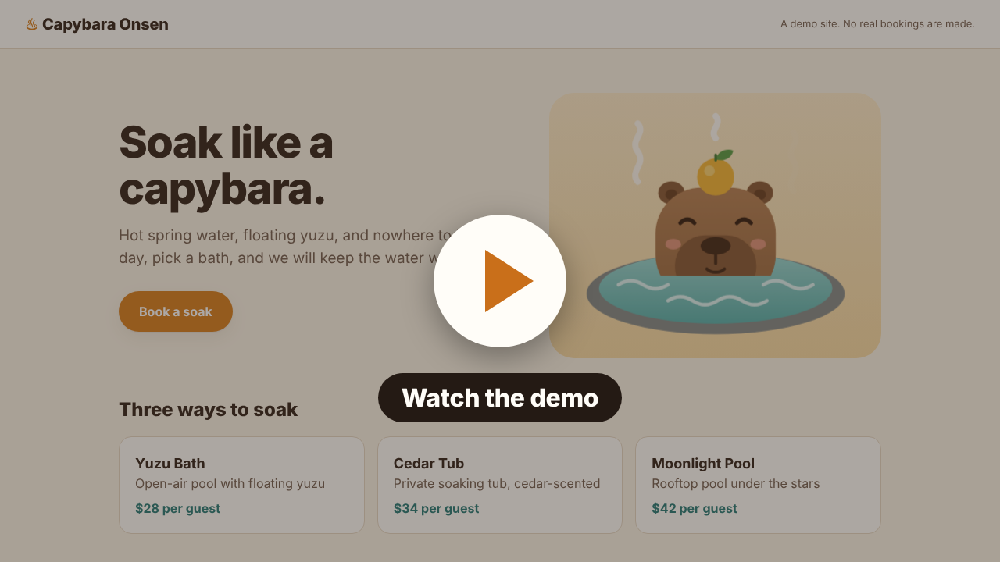
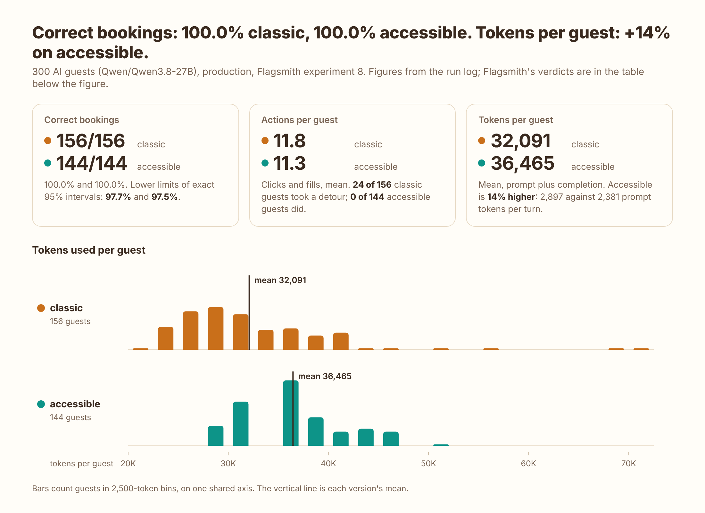
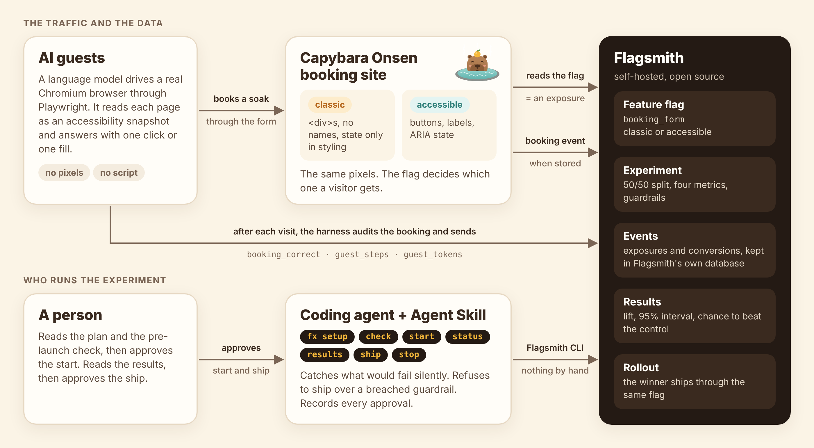
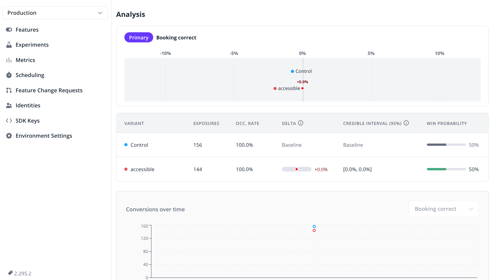

# Capybara Onsen

**AI agents are starting to book, buy and fill in forms for people. We ran a real A/B test on Flagsmith to find out what an accessibility upgrade does to them, with AI guests driving real browsers and a coding agent running the whole experiment under human approval.**

[](https://www.youtube.com/watch?v=VjG-qZ8OaYg)

**[Demo video on YouTube](https://www.youtube.com/watch?v=VjG-qZ8OaYg).** Built for [Toggle Wars: The Flagsmith Experimentation Hackathon](https://www.wemakedevs.org/hackathons/flagsmith) and entered in all four tracks.

## What it is

Capybara Onsen is a hot-spring booking site whose booking form exists in two versions behind one Flagsmith feature flag. A person cannot tell them apart, pixel for pixel, but an AI agent can, because it reads the accessibility tree and not the screen. A Flagsmith experiment splits AI guests, each one a language model driving a real browser, between the two versions and measures correct bookings, steps and tokens. A coding agent runs that experiment from plan to rollout through an Agent Skill built on the Flagsmith CLI, stopping for a named person before the start and before the ship, and all of it runs on self-hosted Flagsmith from one command.

## The problem

- **Agents are a new kind of visitor.** They do not look at your page. They read its accessibility tree: the names, roles and states in the markup.
- **So every markup change is a product change for them,** including the accessibility work teams ship anyway. You cannot review that by eye: the two versions can look identical, as ours do.
- **And experiments fail quietly.** Events are dropped, a variation is served before the start, a split breaks. When a coding agent is the one running the test, nothing stands between a mistake and production.

## Our solution

**1. Two versions of one form, behind one flag.** The classic version is built the way a lot of hand-rolled UI is: clickable `<div>`s, icon buttons with no names, state shown only by styling. The accessible version is the same design in real buttons, labels and ARIA state. `npm run parity` compares screenshots of the two, and zero pixels differ.

| What a person sees | What an AI agent reads |
|---|---|
|  |  |

**2. AI guests as the traffic.** Each guest is a language model with a booking to make, given in plain language: a day, a preferred time (or the next later one if that is sold out), a number of guests, a bath, extras, a name and an email. It drives a real Chromium through Playwright, sees only the accessibility snapshot, and never knows which version it was served. Nobody types in a conversion rate. Every booking is a model succeeding or failing at a real form.


*The same brief on both versions. On the classic form the guest misses that a time is sold out and keeps clicking. On the accessible form it reads `[disabled]` and moves on. This is the hardest brief of the run, filmed outside the experiment.*

**3. A Flagsmith experiment, registered in advance.** The hypothesis, four metrics and the decision rule were [committed](experiments/HYPOTHESIS.md) before the experiment started. Flagsmith assigns the versions, stores the events and computes the results.

**4. An agent runs it. A person approves it.** Our [Agent Skill](skills/flagsmith-experiment/SKILL.md) takes a coding agent through set-up, pre-launch checks, start, results and rollout on the Flagsmith CLI. It catches the failures that are otherwise silent, waits for a named person before anything changes for users, and refuses to ship over a breached guardrail.

## What we found

300 AI guests went through the registered experiment in Production.

| | Classic form | Accessible form |
|---|---|---|
| Correct bookings, the primary metric | 156 of 156 | 144 of 144 |
| Guests who wasted at least one action | 24 of 156 | **0 of 144** |
| Tokens per guest | 32,091 | 36,465, which is **13.6% more** |
| Wasted an action, all six runs, 840 guests | 45 of 418 | **0 of 422** |

- **Accessible markup removed every detour.** On the classic form, guests clicked sold-out times that the form marks only by how they look, or pressed the wrong one of two unnamed stepper buttons. On the accessible form, across 422 guests in six runs, not one wasted an action.
- **Bookings came out equally correct,** because a capable agent notices its mistake and recovers.
- **But the accessible page is longer to read,** and an agent reads it again on every step. That cost 13.6% more tokens per guest and breached a guardrail.
- **So the tooling refused to ship,** until a person had seen the cost and accepted it. A person did, because the upgrade is for people, and Flagsmith rolled it out to everyone.

This is the outcome we had registered before the run: bookings hold, tokens go up. The full write-up, every guest's transcript and the five other runs are in [experiments/results](experiments/results/README.md).



## Architecture



## Sponsor technology

| Sponsor | What we used | What it does in this project |
|---|---|---|
| **[Flagsmith](https://www.flagsmith.com/)** | Feature flags, multivariate | One flag, `booking_form`, picks the form version for every visitor, and later ships the winner. |
| | Experimentation | A 50/50 split, four metrics with guardrails, and Bayesian results that decide the rollout. |
| | Node SDK | `getExperimentFlag` records exposures. `trackEvent` sends the conversions. |
| | Flagsmith CLI v2 | Everything the coding agent does: create, check, start, read results, roll out. |
| | Self-hosted, open source | The whole stack in Docker, with events stored in Flagsmith's own database. |
| | Agent Skills | `flagsmith-experiment`, a skill that takes an agent through the whole experiment. |

## Flagsmith in detail

### Feature flags

`booking_form` is a multivariate flag with a control value, `classic`, and one variation, `accessible`. The site reads it once per visitor in [app/server.mjs](app/server.mjs) and renders that version. If Flagsmith cannot be reached, the site serves the control and counts it, and a run with any such fallback is thrown away. When the experiment ended, the same flag rolled the winner out: 20 of 20 fresh identities got `accessible`. Two environments keep rehearsal apart from the real thing. Staging is a sandbox an agent may run alone, and Production needs a named person. Identity overrides pinned the two guests filmed for the video to one version each.

### Experimentation

| | |
|---|---|
| Hypothesis | The accessible form does not reduce correct bookings by AI guests. We predicted that bookings and steps would hold and that tokens would rise by about 18%. |
| Variants | `classic` (control) and `accessible`, behind `booking_form`, split 50/50 |
| Primary metric | Correct booking, from the `booking_correct` event: exactly one booking, matching the brief on every field |
| Guardrails | Completed bookings, steps per guest and tokens per guest, each registered as "should not" get worse |
| Traffic | 300 AI guests, with the results read once, after the last guest |
| Decision rule | Ship if bookings hold. A person must accept any breach of steps or tokens. |

Exposures and events are stored in Flagsmith's own database, so there is no warehouse to set up. Flagsmith computes the lift, the 95% interval and the chance to beat the control, and those numbers decided the outcome.



### Node SDK

Reading the flag is what records the exposure, and storing a booking is the conversion. In short:

```js
const flag = await flagsmith.getExperimentFlag('booking_form', guestId);

flagsmith.trackEvent('booking_completed', { identifier: guestId, value: booking.total });
```

After each visit the guest harness compares the stored booking with the brief and sends `booking_correct`, `guest_steps` and `guest_tokens` the same way ([guests/run.mjs](guests/run.mjs)).

### Flagsmith CLI and the Agent Skill

[`fx`](skills/flagsmith-experiment/scripts/fx) is a bash script on top of the Flagsmith CLI: `flagsmith feature create`, `flagsmith feature variant add`, `flagsmith evaluate --identity`, and `flagsmith api` for the experiment endpoints. The [skill](skills/flagsmith-experiment/SKILL.md) turns it into a job an agent can follow: plan, check, human-approved start, results with a verdict, rollout.

```
$ fx check --flag booking_form
ok    warehouse connected
ok    variation 'accessible' exists and has a key
ok    event 'booking_correct' has been received here before
...   (and the same for the other three events)
ok    nothing has changed for users yet: 20 of 20 probe identities get the control (classic)
ready. Starting changes what users are served: show the user experiments/booking_form.json and this output, ask, then: fx start --approved-by NAME

$ fx ship --flag booking_form --winner accessible
fx: a guardrail is breached: Guest tokens. Ship control or keep collecting. Use --force only once the user has seen this and accepted it.
```

- **Safe around production.** An experiment is created and started in one approved step, because a created experiment already serves its variation. Stopping is always allowed. Every start, ship and refused ship is recorded with a name in [experiments/approvals.tsv](experiments/approvals.tsv).
- **Small.** The instructions are about 1,600 tokens, and the output of the whole production job was about 600. A fresh agent ran the job in 15 tool calls. The prompts and every command are in [docs/skill-tests](docs/skill-tests/README.md).
- **Creative with the CLI.** `flagsmith evaluate --identity` on throwaway identities proves that nothing is live before a start and that the rollout is live after it. The list of event names Flagsmith has received catches a misspelt event before it costs a day.

### Self-hosted, open source

`docker compose up` starts Flagsmith 2.295, PostgreSQL and the task processor with Experimentation switched on. [scripts/bootstrap.mjs](scripts/bootstrap.mjs) then creates the admin account, the project, two environments, the warehouse connections and the keys without anyone opening the dashboard. `./scripts/demo.sh` does all of that and runs a complete experiment with 120 AI guests. From a fresh clone it took 6 minutes 56 seconds, and its output is in [docs/demo-run.txt](docs/demo-run.txt).

### What we would tell the Flagsmith team

Building on the Experimentation beta turned up three things worth knowing, written up with reproductions in [docs/flagsmith-feedback.md](docs/flagsmith-feedback.md).

1. With the payload from the agent set-up guide, an experiment serves its variation as soon as it is created, before it is started.
2. The sample-ratio check does not run when the variation was added with weight 0, which is what the guide instructs. `fx` computes it instead.
3. When both versions convert at 100%, the dashboard announces a confirmed winner at 50% probability.

## The four tracks

| Track | What we entered | Start here |
|---|---|---|
| 1. Test Something Real | One registered experiment on the booking form, with 300 AI guests | [The pre-registration](experiments/HYPOTHESIS.md), [the results](experiments/results/README.md) |
| 2. AI Agents and Feature Flags | A coding agent runs the experiment through the Flagsmith CLI, and a person approves the start and the ship | [`fx`](skills/flagsmith-experiment/scripts/fx), [the approvals record](experiments/approvals.tsv) |
| 3. Build on Open Source Flagsmith | Self-hosted Flagsmith with a headless bootstrap, a one-command demo and a reusable guest harness | [docker-compose.yml](docker-compose.yml), [scripts](scripts), [guests](guests) |
| 4. Flagsmith Agent Skills | The `flagsmith-experiment` skill | [The skill](skills/flagsmith-experiment/SKILL.md), [the two fresh-agent tests](docs/skill-tests/README.md) |

## Run it yourself

You need Docker with Compose v2, Node 22 or later, `jq`, `curl`, the [Flagsmith CLI](https://docs.flagsmith.com/integrating-with-flagsmith/CLI) v2, and an API key for an OpenAI-compatible chat endpoint, which powers the guests. We used `Qwen/Qwen3.8-27B` on Weights & Biases Inference. Ports 8000 and 3000 must be free. The scripts are written for Linux and macOS and have been run on Linux only. The first run downloads Playwright's Chromium.

```bash
cp .env.example .env    # then fill in OPENAI_BASE_URL, OPENAI_API_KEY and OPENAI_MODEL
```

```bash
./scripts/demo.sh
```

That one command starts Flagsmith, creates the admin account, project and environments, starts the booking site, sets the experiment up, rehearses it, runs the pre-launch check, starts it in Staging, sends 120 AI guests through it and prints Flagsmith's results. It takes about seven minutes and a little over 4 million tokens. It never ships. To decide, in the same terminal:

```bash
source .flagsmith/flagsmith.env    # the CLI's login for the local instance, with Staging as its environment
```

```bash
skills/flagsmith-experiment/scripts/fx stop --flag booking_form --log data/logs/demo-approvals.log
```

```bash
skills/flagsmith-experiment/scripts/fx ship --flag booking_form --winner accessible --approved-by "Your name" --log data/logs/demo-approvals.log
```

`fx ship` will most likely refuse, because the token guardrail has been breached in every run so far. Adding `--force` accepts that cost, as a person did in Production.

The dashboard is at http://localhost:8000, and the login is in `.flagsmith/state.json`. `npm run app` starts the site again at http://localhost:3000, where `/preview/classic` and `/preview/accessible` show each version. `npm test` runs the unit tests, including the audit that decides whether a booking was correct. `npm run flagsmith:reset` deletes the local instance to start from nothing.

## What is in the repo

| Path | What it is |
|---|---|
| `app/` | The booking site. One renderer draws both versions of the form. |
| `guests/` | The AI guests: the agent loop, seeded briefs, the audit and the runner. |
| `experiments/` | The spec, the pre-registration, the results, and every guest's transcript from every run. |
| `skills/flagsmith-experiment/` | The Agent Skill: `SKILL.md`, the `fx` script and a reference. |
| `scripts/` | The bootstrap, the one-command demo, the parity check and the analysis scripts. |
| `docs/` | Images, the output of a demo run, the logs of the skill tests, and notes for the Flagsmith team. |
| `video/` | The demo video's script and the pipeline that builds it. |

Built with an AI coding assistant, which the hackathon rules allow. Every commit is in the history, including the pre-registration, made before the experiment started.
