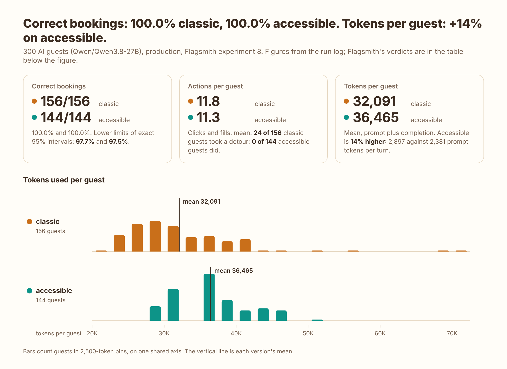

# Results: the accessible booking form and AI guests

The experiment registered in [../HYPOTHESIS.md](../HYPOTHESIS.md) ran in Production on 26 November 2026 from 23:49 to 23:59 UTC. Nelson approved the start. 300 AI guests went through, and the results were read once, after the last guest had finished, as registered.

## Flagsmith's analysis

As printed by `fx results` ([../booking_form.results.txt](../booking_form.results.txt)). The counts, means, lift, interval and chance are Flagsmith's. The last word of each line is `fx` applying Flagsmith's documented thresholds (95% and 5%) to that chance. The sample-ratio line is computed by `fx`, because Flagsmith's own check does not run in this set-up ([why](../../docs/flagsmith-feedback.md)). Flagsmith's dashboard summed the same numbers up as "50% Winner Probability Confirmed", which we think overstates a tie.

```
Booking correct (primary)  control 156/156 100%  accessible 144/144 100%  lift +0% [+0%, +0%]  chance 50%  guardrail ok
Booking completed  control 156/156 100%  accessible 144/144 100%  lift +0% [+0%, +0%]  chance 50%  guardrail ok
Guest steps  control n=156 mean 11.81  accessible n=144 mean 11.27  lift -4.6% [-7.9%, -1.3%]  chance 99.7%  guardrail ok
Guest tokens  control n=156 mean 32090.93  accessible n=144 mean 36464.77  lift +13.6% [+8.9%, +18.4%]  chance 0%  GUARDRAIL BREACHED
sample ratio: ok (control 156 / variation 144, expected 50/50, p=0.488)
```

| | Registered expectation | Result |
|---|---|---|
| H1, correct bookings | should not decrease | **Held.** 156 of 156 and 144 of 144. |
| H2, completed bookings | should not decrease | **Held.** The same counts. |
| H3, steps per guest | should not increase | **Held,** and went down: 4.6% fewer on accessible. |
| H4, tokens per guest | should not increase | **Breached.** 13.6% more on accessible. |

We predicted that H1 to H3 would hold and H4 would be breached by roughly 18%. The breach came in at 13.6%, with an interval that reaches 18.4%.



## What the guests did

Every guest reached the form, made exactly one booking, and got it right. The versions differed in how they got there.

**On the classic form, 24 of 156 guests took a detour. On the accessible form, none of 144 did**: every accessible guest used the fewest actions its brief allowed.

- **20 of the 24 clicked a sold-out time.** The classic form shows a sold-out time by striking it through. In the accessibility snapshot it differs from a free time only by lacking `[cursor=pointer]`. A guest clicks it, nothing happens, and it tries something else. 12 of the 20 wasted one click this way, 4 wasted two, and 4 wasted four, five, six and nine: 44 wasted clicks in all. From the longest ([prod1_g0280](transcripts/prod1_g0280.json), 22 actions where 13 would do):

  > "1:00 PM didn't register in the summary, suggesting it's sold out. Trying the next later time, 2:30 PM."
  > "Time still shows 'Not chosen yet'; I'll try clicking 1:00 PM again to select it."

  Of the 36 classic guests whose preferred time was sold out, 20 clicked a sold-out time at least once. The other 16 did not click one: the guests' instructions say that `[cursor=pointer]` marks what looks clickable, and guests who give a reason say the time is "not clickable". Of the 35 accessible guests in the same position, none clicked one: there the same time reads `radio "1:00 PM" [disabled]`.
- **The other 4 were the guest stepper.** Its plus and minus have no names on the classic form. Each of these guests, part of the way up to its number, pressed minus once and had to press plus again: two actions. From [prod1_g0097](transcripts/prod1_g0097.json):

  > "Guests still shows 5 after clicking e73; let me try the other button e71 to change the count."
  > "Guest count is 4 but I need 6, so I'll click the plus button to increase it."

The 24 detours cost 52 actions, a third of an action per classic guest. All of them are listed in [detours.csv](detours.csv), with the guest's own note after its first wasted action.

**Bookings still came out right** because the form echoes every selection as text in a summary card. A guest that clicked the wrong thing could see that the summary had not changed, and tried something else.

**Part of the difference in steps is chance.** The briefs that happened to go to the accessible form were slightly shorter: they needed 11.27 actions on average, against 11.48 for the classic form's. So of the 0.54 actions between the versions (11.81 against 11.27), the detours explain 0.33 and the luck of the draw 0.21. The same luck works against the token result: per action that a brief needed, accessible guests used 15.7% more tokens, a little more than the 13.6% per guest.

**The accessible form costs more to read.** Its accessibility snapshot is longer: 2,897 prompt tokens per turn against 2,381, which is 22% more. Accessible guests needed slightly fewer turns (12.3 against 12.9) and wrote less on each one (75 completion tokens against 113), but that does not make up for the longer pages. The net is 13.6% more tokens per guest.

## The same pattern in five other runs

The registered experiment is one run. Five others used the same final set-up: a pilot and the two skill tests in Staging before it, and two runs of the one-command demo from fresh clones after it. None of them is part of the registered analysis. In each cell the classic form comes first.

| Run | Guests | Correct bookings | Guests who wasted an action | Actions the briefs needed | Tokens per guest |
|---|---|---|---|---|---|
| Pilot 2 | 60 | 25 of 25, 35 of 35 | 3 of 25, 0 of 35 | 11.56, 11.51 | 31,630, 37,414 (+18%) |
| Skill test 1 | 120 | 63 of 63, 57 of 57 | 4 of 63, 0 of 57 | 11.75, 11.98 | 31,902, 38,954 (+22%) |
| Skill test 2 | 120 | 55 of 55, 65 of 65 | 6 of 55, 0 of 65 | 11.98, 11.75 | 32,915, 38,215 (+16%) |
| **The registered experiment** | 300 | 156 of 156, 144 of 144 | 24 of 156, 0 of 144 | 11.48, 11.27 | 32,091, 36,465 (+14%) |
| Demo run 1 | 120 | 61 of 61, 59 of 59 | 3 of 61, 0 of 59 | 11.92, 11.80 | 32,503, 38,384 (+18%) |
| Demo run 2 | 120 | 57 of 58, 62 of 62 | 5 of 58, 0 of 62 | 11.45, 12.24 | 31,045, 39,943 (+29%) |
| All six | 840 | 417 of 418, 422 of 422 | 45 of 418, 0 of 422 | | |

Three things hold in every run: no accessible guest wasted an action, some classic guests did, and the accessible form cost more tokens. The one wrong booking in 840 was on the classic form. That guest selected its preferred time, which was free, then decided it was sold out and booked a later one.

Raw steps are a different matter. How many actions a guest takes depends mostly on its brief, and the briefs are dealt at random. In demo run 2 the accessible form drew longer briefs (12.24 actions needed, against 11.45), so its guests took more steps and the steps guardrail came out as breached, although none of them wasted an action. The token difference in that run is inflated in the same way. In the registered experiment the draw went slightly the other way. Counting the actions beyond what a brief needs takes that luck out, and that is the column above. We registered raw steps, so raw steps are what the experiment reports. Next time we would register the wasted actions.

A first pilot of 80 guests is not in the table. It ran before two fixes to our own set-up: the guests were shown Playwright's raw element references, whose format changes between pages, and several accessible controls carried an `aria-label` that only repeated their visible text. Bookings were correct there too (46 of 46 and 34 of 34), but most guests on both versions wasted actions.

The two skill tests and the two demo runs used the same 120 briefs, dealt to the two versions differently each time, so the 840 guests worked through 480 distinct briefs. The transcripts and tallies of all these runs are in [../other-runs](../other-runs), and `node scripts/detours.mjs` recomputes the table from them. The two demo runs are the last two of three attempts: the first failed early because a leftover process of ours was holding the site's port, which `demo.sh` now checks for.

## Bounds on the booking rate

Flagsmith's interval for both booking metrics is `[+0%, +0%]`. It comes from a normal approximation, which has no width when every identity converts, so it overstates what 300 guests can show. The lower limits of exact (Clopper-Pearson) two-sided 95% intervals for each version's correct-booking rate are 97.7% for classic (156 of 156) and 97.5% for accessible (144 of 144). What the data support is that each version fails fewer than about 1 guest in 40, and that any difference between them is smaller than that.

## The decision

The registered rule was to ship the accessible form if H1 and H2 hold, with a person explicitly accepting any breach of H3 or H4. Both held, and H4 was breached, so the tooling would not ship on its own.

At 00:00 UTC, before anybody had accepted the token cost, we ran the ship command without an approver, on purpose, to put the refusal on record:

```
$ fx ship --flag booking_form --winner accessible
fx: a guardrail is breached: Guest tokens. Ship control or keep collecting. Use --force only once the user has seen this and accepted it.
```

Nelson was then shown the results above, with a recommendation to ship, and approved. At 00:39 UTC:

```
$ fx ship --flag booking_form --winner accessible --approved-by "Nelson" --force
overriding: a guardrail is breached: Guest tokens. Accepted by Nelson.
experiment id=8 status=completed decision=variant
recorded in experiments/approvals.tsv
rolled out: 20 of 20 probe identities now get 'accessible'
```

The start, the refused attempt and the ship are the three lines of [../approvals.tsv](../approvals.tsv). The accessible form is now what every visitor gets.

## What this experiment cannot show

- It used one guest model, one way of perceiving pages (the accessibility snapshot, no screenshots) and one form. A weaker model, or an agent that works from screenshots, may behave differently.
- The form echoes every selection as text in a summary card, so state is readable in both versions. A form without that echo would test the classic version harder.
- Correct bookings sit at 100% in both versions, so the experiment can show that the accessible form does no harm to bookings, and cannot show that it helps. The hypothesis was registered without a margin for "no harm", and the 300 guests were not chosen from a power calculation. What they can exclude is in the bounds above.
- Steps and tokens are measured by the guest harness and sent to Flagsmith as events after the run. Only the exposure and `booking_completed` come from the site itself.
- The token cost falls on whoever runs the agent, not on the site. It matters to a site only as far as cheaper visits make agents likelier to finish.

## What was not registered

The detour counts, their classification, the split of the step difference and the token breakdown are exploratory. They were looked at after the results, to explain them. The four registered metrics and the decision rule were not changed.

## Files

| File | What it is |
|---|---|
| `log/` | The output of every command in the run, in order, including the refused ship attempt. `2-start.txt` names the record `experiment-approvals.log`: that was the file's name when the experiment started. It was renamed to `approvals.tsv` before the ship, with its one line unchanged, because the repository ignores `*.log` files. |
| `guests.csv` | One row per guest: version, outcome, actions, extra actions, turns, tokens. |
| `detours.csv` | One row per guest that used more actions than its brief needed: how many, how many were clicks on sold-out times, and the guest's own note. |
| `transcripts-all.tar.gz` | The complete transcripts of all 300 guests. |
| `summary.json` | Per-version totals, means and exact bounds. |
| `flagsmith-experiment.json`, `flagsmith-results.json` | The experiment and its results as Flagsmith's API returned them. |
| `transcripts/` | Seven complete guest transcripts: the shortest run on each version, the three longest detours, one stepper detour, and one accessible guest meeting a sold-out time. |
| `results.html`, `results.png` | The figure. |
| [`../approvals.tsv`](../approvals.tsv) | Who approved what, and what was refused. |
